### 📅 Week 5 Reading Assignment

::: {.panel-tabset}

## 🎯 Key Overview

::: {.p-3 .bg-light .rounded .border-start .border-primary .border-3}
*   **Additional Assigned Reading:** Explorations: Chapters 10 and 11
*   **Important Species:** *Homo habilis*, *Homo rudolfensis*, *Homo ergaster*, *Homo erectus*, *Homo heidelbergensis*, *Homo neanderthalensis*, *Homo sapiens*
*   **Key Terms:** Lumpers, Splitters, Grades, Clades, mosaic traits/evolution, extinct, extant, monophyletic, polyphyletic, paraphyletic, sexual dimorphism, morphotype, Stone Tool Industry, Taphonomy, Oldowan Tools, Lomekwian Tools
*   **Summary:** This section covers some of the primary debates mentioned in the assigned reading. Of note are the opposing perspectives of taxonomic Lumpers and Splitters, the use of Gradistic and Cladistic designations, and interpretations of early stone tools, stone tool industries, and hominin tool using behavior.
:::

## 📖 Chapter 10 *(≤ 15 pages)*

*   **I. Defining the Genus Homo** (Pgs. 2–3)
*   **II. *Homo habilis*: The Earliest Members of our Genus** (Pgs. 4–7)
    *   *Controversies over Classification of Homo habilis* (Pgs. 6–7)
*   **III. *Homo habilis* Culture and Lifeways** (Pgs. 8–9)
    *   *Early Stone Tools* (Pg. 8)
    *   *Stone Tool Use and the Diet of Early Homo* (Pg. 9)
*   **IV. *Homo erectus*: Biological and Cultural Innovations** (Pgs. 9–10)
    *   *Homo erectus Anatomy* (Pg. 10)
*   **V. Special Topic: How we Became Hairless, Sweaty Primates** (Pg. 14)
*   **VI. *Homo erectus* Lifeways** (Pgs. 14–16)
    *   *Tool Technology: Acheulean Tool Industry* (Pgs. 15–16)
*   **VII. Subsistence and Diet** (Pgs. 16–17)
    *   *Tool Use, Cooking, and Fire* (Pg. 17)
    *   *Migration Out of Africa* (Pg. 17)
*   **VIII. The Big Picture of Early Homo** (Pgs. 18–19)

## 📖 Chapter 11 *(≤ 12 pages)*

*   **I. The Changing Environment** (Pgs. 2–3)
*   **II. Surviving During the Middle Pleistocene** (Pg. 3)
*   **III. Neanderthals** (Pgs. 6–11)
    *   *Neanderthal Culture: Tool Making and Use* (Pg. 9)
    *   *Neanderthal Culture: Hunting and Diet* (Pg. 10)
    *   *Neanderthal Culture: Caring for Injured and Sick* (Pgs. 10–11)
*   **IV. The Middle Stone Age: Neanderthal Contemporaries in Africa** (Pgs. 13–14)
*   **V. Where Did They Go? The End of the Neanderthals** (Pgs. 14–15)
*   **VI. Denisovans** (Pgs. 15–16)

:::

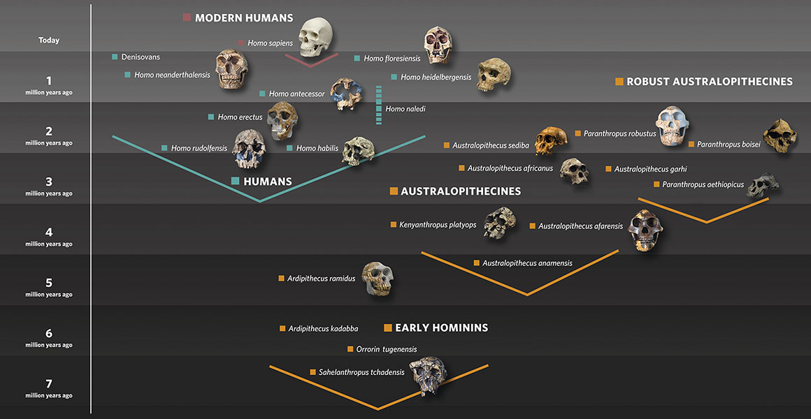{#fig-Homo .lightbox width="60%"}


# The Genus Homo

We left off in our last discussion by considering the diet and morphological shift in Gracile Australopithecines. It's wild that that part of my lectures had to change as recently as 2025. The overturn
of our commonly held belief that the encephalization jump in *Au. africanus* resulted from increased consumption of animal protein (@Brand-Miller2026; @Ludecke2025; @Sponheimer1999) has shifted the paradigm on early human evolution.
But the science is always changing. Who knows what the next round of research will unveil.

As stated last week, this overturn was difficult to swallow in part because of how well the original theory matched the evidence. There is no question that the masticatory and digestive systems of this species reduced
in size and power. It is further evident that brain growth began to trend positively with this shift, leading to increased encephalization. We can also be farily certain that these combined changes are a result of a new dietary niche. I guess with
the way things stand, we must accept that increased omnivory with the inclusion of more glucose and insect protein was enough to kick this trend into gear. That being said, we have much stronger evidence for meat-eating (carnivory)
in the hominins which evolve from the gracile australopithecine line. 

This last section of Unit 1 focuses on the evolution of our genus and, ultimately, our species. Even more than our last discussion, however, interpretations of this fossil record illustrate an academic battleground. Almost every aspect of 
these chapters reflects controversy and debate. As you read through the textbook assignment you will come to see that much of the disagreement centers on a couple of general themes and perspectives in paleoanthropology. These amount to the 
opposing perspectives of taxonomic ***lumpers*** and ***splitters***, the acceptance of ***grade*** versus ***clade*** categories, and the diagnosis of stone tools versus manufactured ***stone tool industries***. We will cover each of these themes in this 
supplemental text. But first, a couple of general notes about our genus.

The genus ***Homo*** is commonly defined by an increase in carnivory, use and manufacture of stone tools, and decreasing robusticity coincident with increased encephalization. The most widely accepted species in the genus include *Homo habilis*,
*Homo erectus*, *Homo neanderthalensis*, and *Homo sapiens* (though see @tbl-Homo). Despite the ongoing contention, most authors agree that, in relation to australopithecines, Homo was/is more adaptable and highly cultural. The notion of 
cumulative culture encapsulates the shift. Once our ancestors begin manufacturing tools and processing food (cutting, grinding, cooking, *et cetera*) there occurs a positive feedback loop where we begin to learn how to manipulate our 
enviornment at an exponential rate. This is the legacy of our genus. The debates, then, do not so much relate to *what was significant about Homo* or even *the evolutionary advance of the genus* but focus instead on how we delineate and the genus
and differentiate the species within. 

::: {.card .border-success .w-70 .me-auto .mb-3}
::: {.card-header .bg-success .text-white}
**Proposed species in the genus Homo**
:::
::: {.card-body}

<details>
<summary>Click to expand/collapse table</summary>

| Species | Region/Country | 
|---|---|
| ***H. habilis***| southern and eastern Africa |  
| ***H. rudolfensis*** | eastern Africa |  
| ***H. ergaster*** | southern and eastern Africa |  
| ***H. erectus***| eastern Asia |  
| ***H. naledi*** | southern Africa |  
| ***H. heidelbergensis*** | western Eurasia and northern Africa |  
| ***H. neanderthalensis*** | western Europe |  
| ***H. bodoensis*** | northern Africa and parts of western Europe |  
| ***H. antecessor*** | western Europe (Spain) |  
| ***H. luzonensis*** | ISEA (Philippeans) |  
| ***H. floresiensis*** | ISEA (Indonesia) |  
| ***H. longi*** | eastern Asia (China) |  
| ***H. juluensis*** | eastern Asia (China) |  
| ***H. georgicus*** | western Asia (Georgia) |  
| ***H. cepranensis*** | western Europe (Italy) |  


: Not even an exhaustive list of proposed Homo species {#tbl-Homo}

</details>

:::
:::

# Theory and Philosophy: Splitters vs. Lumpers and Grade vs. Clades

The most poignant undertones of your assigned reading reflect different philosophies in paleoanthropology. It is worth noting that we (as people) make up the categories applied to the world around us. Outside of this discussion, you
can find heated debate regarding whether or not our categories are *real* at all (is the classification of a *species* grounded in reality? Is the divide between species real?). This is not to say that the taxa do not reflect a certain degree of biological truth, but
the dividing lines between these units are determined by a governing body of biologists (such as the International Commission on Zoological Nomenclature or ICZN). I mention this simply to illustrate that, in these debates, there really cannot 
be a *right* or *wrong* opinion, only an *accepted* or *unaccepted* opinion. Now we can dive into these different approaches.

## *To split or not to split*

::: {#fig-DQ style="float: left; margin-right: 15px; max-width: 30%;"}
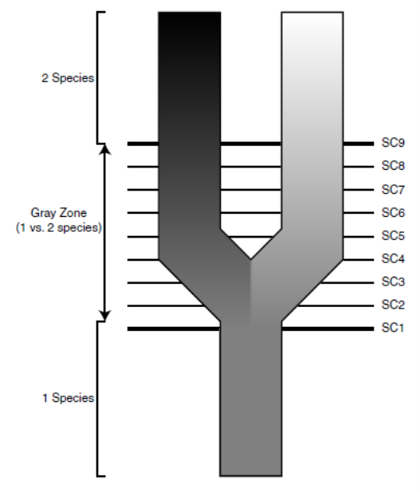{.lightbox}

From @deQueiroz2007. Illustrating how different criteria can be used at different stages of speciation. *SC* refer to Species Criteria defined by different species concepts outlined in the article. 

:::

::: {#fig-taxonomy style="width: 300px; float: right; margin-left: 20px; margin-bottom: 15px;"}

```{=html}
<div id="taxonomySlider" class="carousel slide" data-bs-interval="false" style="width: 100%; overflow: hidden; position: relative;">
  
  <!-- Carousel Image Slides Track -->
  <div class="carousel-inner">
  
    <!-- Slide 1 (active) -->
    <div class="carousel-item active" style="position: relative;">
      <!-- Slide Number Badge overlaying the top-right corner -->
      <div class="carousel-caption" style="position: absolute; top: 10px; right: 10px; left: auto; bottom: auto; padding: 0; z-index: 10;">
        <span style="background: rgba(0, 0, 0, 0.65); color: #fff; padding: 4px 8px; border-radius: 4px; font-size: 12px; font-weight: bold; font-family: sans-serif;">1 / 4</span>
      </div>
      
	  <a href="../images/Homo/giraffe.png" class="lightbox" data-gallery="taxonomy-gallery" title="Giraffe" data-description="I have a distinct opinion on this one. These Giraffe 'species' are delineated by their color pattern, home range, and genetics. Otherwise they are the exact same. I've had long arguments with the primary author of the study (@Fennessy2016)">
        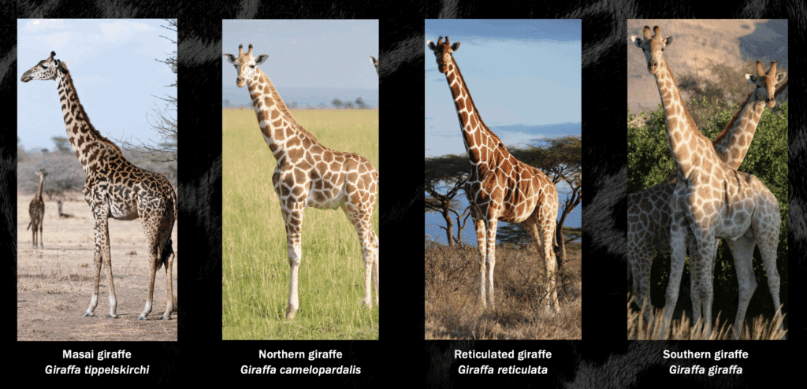
      </a>
    </div>
    
    <!-- Slide 2 -->
    <div class="carousel-item" style="position: relative;">
      <!-- Slide Number Badge -->
      <div class="carousel-caption" style="position: absolute; top: 10px; right: 10px; left: auto; bottom: auto; padding: 0; z-index: 10;">
        <span style="background: rgba(0, 0, 0, 0.65); color: #fff; padding: 4px 8px; border-radius: 4px; font-size: 12px; font-weight: bold; font-family: sans-serif;">2 / 4</span>
      </div>
      
      <a href="../images/Homo/hens.png" class="lightbox" data-gallery="taxonomy-gallery" title="Galinule vs Mudhen" data-description="The Common Galinule ranges across North America while the Common Mudhen is known throughout the UK. The species appear nearly identical but display distinctions in mating and nesting behavior">
        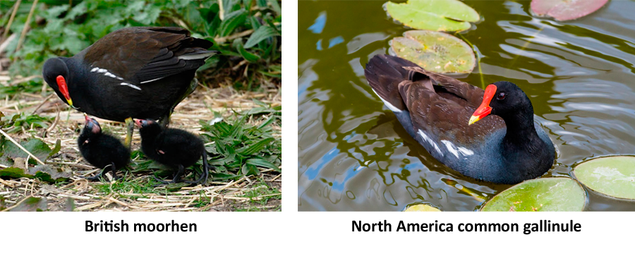
      </a>
    </div>
	
    <!-- Slide 3 -->
    <div class="carousel-item" style="position: relative;">
      <!-- Slide Number Badge -->
      <div class="carousel-caption" style="position: absolute; top: 10px; right: 10px; left: auto; bottom: auto; padding: 0; z-index: 10;">
        <span style="background: rgba(0, 0, 0, 0.65); color: #fff; padding: 4px 8px; border-radius: 4px; font-size: 12px; font-weight: bold; font-family: sans-serif;">3 / 4</span>
      </div>
      
      <a href="../images/Homo/dinos.jpg" class="lightbox" data-gallery="taxonomy-gallery" title="Triceroptops vs. Torosaurus" data-description="Things get trickier with fossils. One the one hand these look *different enough* to be separate species. On the other, one is more of an exagerated form of the other (seldom accounting for species-level distinction)">
        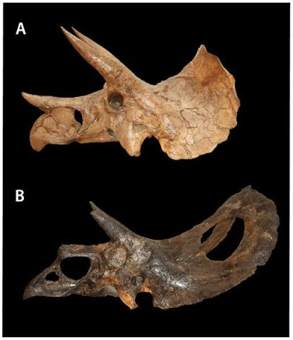
      </a>
    </div>
    
    <!-- Slide 4 -->
    <div class="carousel-item" style="position: relative;">
      <!-- Slide Number Badge -->
      <div class="carousel-caption" style="position: absolute; top: 10px; right: 10px; left: auto; bottom: auto; padding: 0; z-index: 10;">
        <span style="background: rgba(0, 0, 0, 0.65); color: #fff; padding: 4px 8px; border-radius: 4px; font-size: 12px; font-weight: bold; font-family: sans-serif;">4 / 4</span>
      </div>
      
      <a href="../images/Homo/habilis.jpg" class="lightbox" data-gallery="taxonomy-gallery" title="*H. habilis* vs *H. rudolfensis*" data-description="Like the dinosaurs in the last slide, we have to determine if these are separate species or if one is simply an exaggerated version of the other (or a regional variant)">
        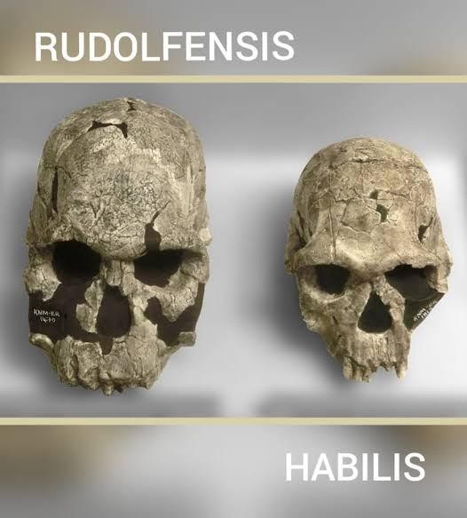
      </a>
    </div>
	
  </div>
  
  <!-- Left Control Arrow -->
  <button class="carousel-control-prev" type="button" data-bs-target="#taxonomySlider" data-bs-slide="prev">
    <span class="carousel-control-prev-icon" aria-hidden="true" style="filter: invert(1); transform: scale(1.0);"></span>
    <span class="visually-hidden">Previous</span>
  </button>
  
  <!-- Right Control Arrow -->
  <button class="carousel-control-next" type="button" data-bs-target="#taxonomySlider" data-bs-slide="next">
    <span class="carousel-control-next-icon" aria-hidden="true" style="filter: invert(1); transform: scale(1.0);"></span>
    <span class="visually-hidden">Next</span>
  </button>
  
</div>

<!-- Inline CSS to make sure text layout behaves nicely on phones -->
<style>
@media (max-width: 576px) {
  div[id^="fig-taxonomy"] {
    float: none !important;
    margin: 0 auto 20px auto !important;
  }
}
</style>
```

Delineating taxa can be tricky. Each of the comparisons in this figure illustrate a point of contention between lumpers and splitters. Many of us find ourselves jumping between sides on a case-by-case basis. 
:::


You have already read a bit on this topic in Chapter 9 of Explorations (allegedly). The opposing philosophies of Lumpers and Splitters regard how researchers divide fossil populations by their observed morphology. One side of the debate considers how
variable species can be when spread over a wide geographic range or influenced by different environments. These are the **Lumpers**. They suggest that subtle differences in morphology are inherent in most, if not all species-level populations, and that they 
are relatively minor modifications to the overall species form. **Splitters**, on the other hand, tend to focus on morphological insights into reproductive isolation (see *BSC* below). They suggest that any unique set of traits which can be population specific qualifies as
diagnostic criteria for species classification. As stated in the book, the philosophies differ on how variation is interpreted. Check out @fig-taxonomy to see examples of how these taxonomic problems take shape. 

While this debate occurs in <span title="the branch of biology that studies living and recent organisms"> **neontological** </span> discussions as well,
it is overwhelmingly more present in paleontology. This is because neontologists often have more distinct means by which they delineate species. The [Biological Species Concept]{ .underline} (BSC), for instance, separates different species based
on whether they can mate and produce fertile, viable offspring (@Mayr1987). Just as it is with the BSC, many neontological definitions are reliant on observing behavior and insights into physiology or genetics. Paleontologists, on the other hand,
do not have such detailed information. All we have to work with are the fragmented and otherwise incomplete skeletons of a few individuals from what would have been large populations of ancient species. These fossils do
not just represent a fragment of the variation present in such populations but, more aptly, a fragment of a fragment of this variation. Paleontologists are thus forced to rely solely on incomplete morphology in our attempt to separate closely related 
fossil populations. 

With such limited information, many pursue species diagnosis by looking for traits that could identify particular adaptive zones (@Simpson1953). Adaptive zones represent the ecological and behavior niche filled by a species which influence the evolution 
of characteristics needed to navigate it. Neanderthals, for instance, are adapted to highly carnivorous diets in the Ice Age landscape of Middle Pleistocene Europe. They are thus distinguished from other species through the presence of 
adaptive features specific to such conditions. By this model, any Middle Pleistocene hominin that is adapted to cold environments (increased robusticity, wide nasal aperture, highly carnivorous diet) would be filtered into 
the "Neanderthal box". While this makes sense, it is important to keep in mind that similar selective pressures can operate simultaneously on different taxa (especially if the taxa share a common ancestor). These definitions therefore can suffer
from their generality, having a tendency to include a wide range of morphologically flexible traits that might suit ephemeral environmental trends. That is to say, they could very well include individuals from different taxa 
which happened to adapt similarly to changing environments (via convergent or parallel evolution). In this way, lumpers run the risk of creating *polyphyletic* groupings that are inconsistent with the evolutionary history of the taxon under 
investigation (look back at the [shared trait caveat](Primates.qmd#shared-trait-caveat) for a refresh on polyphyletic groupings). It is because of this that other paleontologists define species more specifically. 

Instead of looking for broad trends, splitters tend to identify any
distinction in morphology as qualifying criteria for species delineation. More akin to what are called Phenetic (and/or cladistic) species concepts, these researchers recognize distinct patterns in a population as the result of isolation (reproductive) and therefore
as potentially unique evolutionary paths (@Smith2009; @Sneath1973). The concept has strong footing in evolutionary theory but suffers from overlooking the preponderance of regional variation in known species. A phenetic researcher, for instance, 
might (often does) observe the differences in coat color and pattern observed in giraffe populations across Africa as qualifying criteria for species-level distinction (@fig-taxonomy). Each morphological variant clearly represents some degree of genetic isolation (@Fennessy2016) and therefore
could be considered a separate evolutionary line, but can you imagine if we divided modern human populations in this way? No thank you. 

The question at the base of the argument is *when and where in an evolutionary lineage do we draw the dividing line?* @deQueiroz2007 expertly discusses and illustrates the issue (@fig-DQ) showing what he calls the "Grey Zone" in which 
different researchers will ascribe one or two (sometimes more) species to the same population. It is perhaps because of this philosophical stalemate that many paleoanthropologists choose to sidestep the discussion altogether by employing
generalized categories outside of the confines of <span title="a branch of biological classification focused on determining evolutionary relationships between taxa"> **evolutionary systematics** </span>. These categories are used to discuss populations
expected to be related to each other (but in an indeterminate way) and share a distinct adaptive zone. It is largely a *lumper* philosophy but without arguing about which populations represent specific species or genera. When applied in this way,
discussions of fossil populations reflect taxonomic <span title="groupings based on morphological/adaptive similarity rather on strict evolutionary relationships"> **Grades** </span> rather than evolutionary <span title="groups of organisms
consisting of a common ancestor and all descendants. Groups are **monophyletic**"> **Clades** </span>. 

## Grades vs. Clades

Identifying the earliest members of this genus is somewhat tricky. The boundaries between taxa are always a little hazy, which is understandable, but it makes accurately teaching about the human fossil record difficult. 
That being said, I am somewhat pigheaded and masochistic and so feel obligated to represent this topic as accurately as possible. Easy answers seldom reflect reality and so I will illustrate some of the "dirty laundry" of the
field. I know that this is an intro class and that I am supposed to simply tell you all that *Ardipithecus* evolved into *Australopithecus* and *Au. africanus* evolved into *Homo habilis* (as depicted in the textbook), but it 
really isn't that straightforward.
These episodes of speciation, whether anagenic or cladogenic, are observed in the fossil record through species with <span title="a combination of ancestral and derived traits, appearing as similar to both the previous 
and new taxon"> **mosaic traits** </span>. As such, we often come across proverbial "grey areas" in which taxonomic assignment is particularly difficult. 

It might be worthwhile having a short discussion regarding grades and clades. Some of these informal categories that we use are necessary but distinctly not distinct. Gracile and Robust australopithecines, for instance,
are not formal taxonomic categories (though the designation of *Paranthropus* for the latter is certainly an attempt to formalize). These categories often arise when the research community has too little information, or 
is otherwise too divided on how to utilize the information at hand, to agree on a formal group. Hence the issue of gracile australopithecines from last week. This category is based on relative assessment of morphology and
behavior. Gracile australopithecines can be described as the opposite of robust australopithecines in masticatory and/or body size, or it can be described as a specific evolutionary trend with unique adaptations and
shifting behavior. In either case, the definition becomes operationally difficult as it lacks specific criteria in which fossils could be tested against. Such categories, however, are useful in explaining the general
suite of adaptations. The dialog becomes, "while we don't know exactly how to categorize these hominins, we do know that those species deemed to belong to this group share a common suite of behaviors and physical adaptations".

The distinction we are making is known in taxonomy as that between **Grades** and **Clades** (@fig-grades). This is something that you came across in our week 2 textbook reading (Ch. 5: Ways of Organizing Taxa). While establishing a distinct
evolutionary clade is the ultimate goal of any taxonomic assessment, it is simply not always possible. The fossil record is fragmentary, sparse, and often ambiguous. In times past it was common practice to attribute a species
name (including the genus) to any and all hominin fossils found. Regardless of the amount of descriptive morphology available. As we move away from this practice, more researchers are making use of *gradistic* descriptions
until the more formal taxonomic issues are agreed upon and resolved. One of the most pertinent examples of this impasse in paleoanthropology centers on when, where, and how we define the earliest members of the genus Homo.

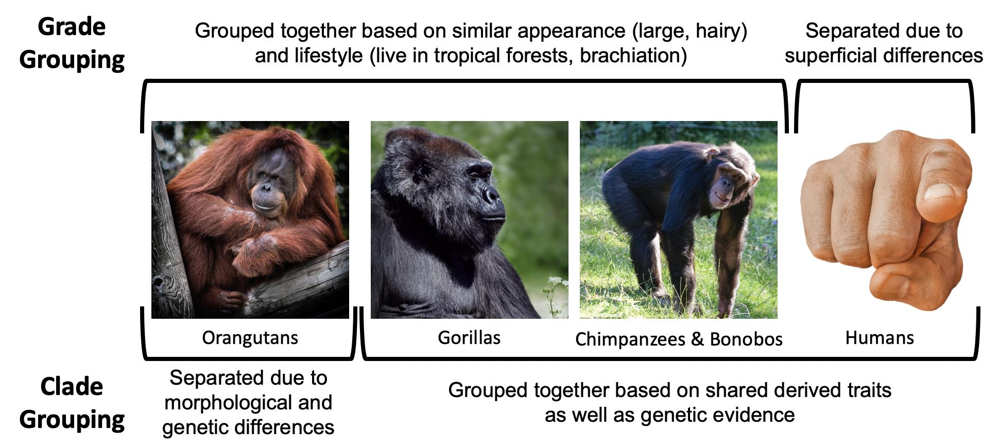{#fig-grades .lightbox width="60%"} 

# Lumper/Splitter Debates

::: {#fig-overlap style="float: right; margin-right: 15px; max-width: 20%;"}
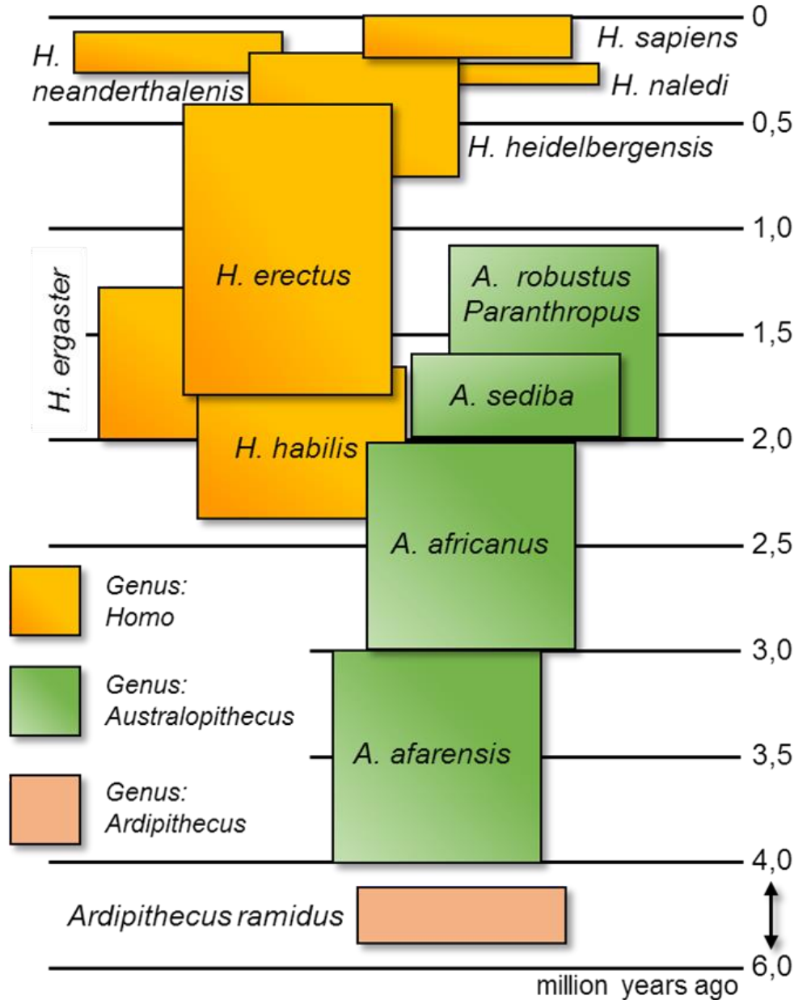{.lightbox}

The image illustrates both temporal and morphological overlap. The right margin illustrates time in Ma. Clearly multiple species co-existed. Make note, however, of the physical overlap of boxes. These overlaps show us
the morphological overlap. *Au. africanus* blends into *H. habilis* and so forth. The more overlap, the foggier the distinction.  

:::


## Australopithecus vs. *H. habilis*

Defining our genus has been a contested endeavor since the time of Linnaeus, Darwin, and Huxley. Historically, the taxonomic world could mostly only agree on the singular <span title="currently living/opposed to extinct"> **extant** </span>
species (being *H. sapiens*). More recently there has been a broad acceptance of *H. neanderthalensis* and *H. erectus* as well, but most of the other 10 plus Homo species are in constant flux. While many of the debates center on whether particular
fossils should be incorporated into the aforementioned accepted Homo species or represent something new, a foundational taxonomic issue concerns how we partition fossils at the genus level. This is discussed a bit in Chapter 9 of your textbook

A distinct facet of this disagreement is the matter of Early 
Homo looking and behaving much the same as gracile australopithecines but illustrating landmark behaviors of Homo. This, again, illustrates the mosaic nature of adaptive shifts. 

There exist two primary camps in this argument: those who believe *Homo habilis* and *Homo rudolfensis* represent the earliest members of our genus, and those that believe them to represent the latest members of Australopithecus. Consider @fig-overlap,
and notice how *Au. africanus* overlaps with *H. habilis*. This not only underscores the coexistence of the two species but shows that they occupy the same morphological, behavioral, and ecological space (though not explicitly said in the graphic). *H. habilis*
is barely distinguishable from *Au. africanus*. There is a slight increase in encephalization, somewhat smaller teeth, and, importantly, an association with a *distinct* stone tool industry. Why the distinction then? Mostly because of the last point. The clear
patterns of a stone tool industry (see below) do not exist in the human fossil record until this moment. While there is evidence of opportunistic tool use and even rudimentary stone fracturing earlier in the record,
there is no patterned industry that we can describe and define until we see *H. habilis* (see Lomekwian tools below). This characteristic has become a defining quality for the genus Homo, but it is not morphological. It does not confer direct physical traits that we can 
associate with human fossils. So what are we supposed to do? The most widely accepted approach is to identify a gradient of evolutionary change that transitions from Gracile Australopithecines to Early Homo. This gradient creates a grey area 
incorporating fossils which exhibit both primitive and derived traits. It draws a line between the genera by using the emergence of the Oldowan Tool Industry and suggests that the larger suite of characteristics that define our genus 
morphologically primary develop at the time of *H. erectus* (which is not too long after this). 


::: {#fig-phylo style="width: 300px; float: left; margin-left: 20px; margin-bottom: 15px;"}

```{=html}
<div id="phyloSlider" class="carousel slide" data-bs-interval="false" style="width: 100%; overflow: hidden; position: relative;">
  
  <!-- Carousel Image Slides Track -->
  <div class="carousel-inner">
  
    <!-- Slide 1 (active) -->
    <div class="carousel-item active" style="position: relative;">
      <!-- Slide Number Badge overlaying the top-right corner -->
      <div class="carousel-caption" style="position: absolute; top: 10px; right: 10px; left: auto; bottom: auto; padding: 0; z-index: 10;">
        <span style="background: rgba(0, 0, 0, 0.65); color: #fff; padding: 4px 8px; border-radius: 4px; font-size: 12px; font-weight: bold; font-family: sans-serif;">1 / 3</span>
      </div>
      
	  <a href="../images/Homo/lineage.jpg" class="lightbox" data-gallery="phylo-gallery" title="Human Phylogeny" data-description="Common approach to the human family tree. The entire group is monophyletic O. tugenensis as the hypothetical common ancestor. Australopithecus evolves into Homo">
        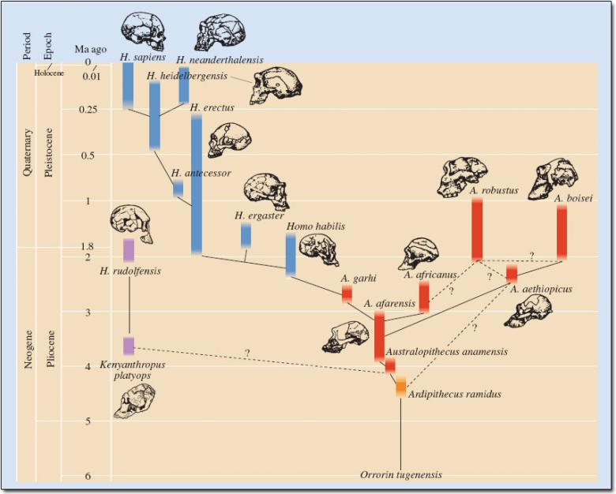
      </a>
    </div>
    
    <!-- Slide 2 -->
    <div class="carousel-item" style="position: relative;">
      <!-- Slide Number Badge -->
      <div class="carousel-caption" style="position: absolute; top: 10px; right: 10px; left: auto; bottom: auto; padding: 0; z-index: 10;">
        <span style="background: rgba(0, 0, 0, 0.65); color: #fff; padding: 4px 8px; border-radius: 4px; font-size: 12px; font-weight: bold; font-family: sans-serif;">2 / 3</span>
      </div>
      
      <a href="../images/Homo/lineage2.png" class="lightbox" data-gallery="phylo-gallery" title="Restructured Phylogeny" data-description="Splitting *H. habilis* and *H. rudolfensis* from the genus Homo and making the two genera sister taxa would require a major restructure of the tree.">
        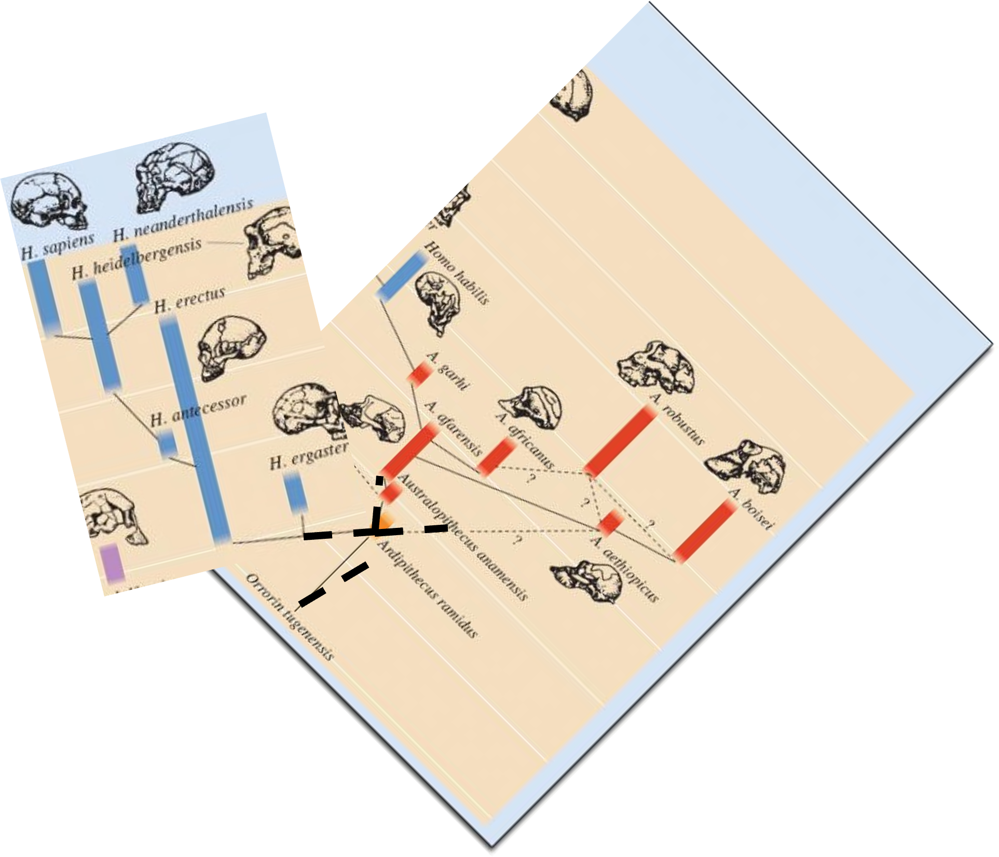
      </a>
    </div>
	
    <!-- Slide 3 -->
    <div class="carousel-item" style="position: relative;">
      <!-- Slide Number Badge -->
      <div class="carousel-caption" style="position: absolute; top: 10px; right: 10px; left: auto; bottom: auto; padding: 0; z-index: 10;">
        <span style="background: rgba(0, 0, 0, 0.65); color: #fff; padding: 4px 8px; border-radius: 4px; font-size: 12px; font-weight: bold; font-family: sans-serif;">3 / 3</span>
      </div>
      
      <a href="../images/Homo/woodphy.png" class="lightbox" data-gallery="phylo-gallery" title="Splitter approach to Genus Homo (classic reference @Wood1999a)" data-description="This clean version illustrates the argument of Wood and Collard (1999). One glaring error is that there are no Homo fossils prior about 2.5 Ma)">
        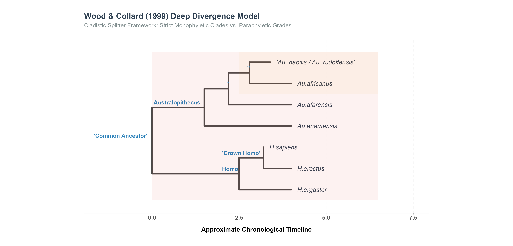
      </a>
    </div>
    
	
  </div>
  
  <!-- Left Control Arrow -->
  <button class="carousel-control-prev" type="button" data-bs-target="#phyloSlider" data-bs-slide="prev">
    <span class="carousel-control-prev-icon" aria-hidden="true" style="filter: invert(1); transform: scale(1.0);"></span>
    <span class="visually-hidden">Previous</span>
  </button>
  
  <!-- Right Control Arrow -->
  <button class="carousel-control-next" type="button" data-bs-target="#phyloSlider" data-bs-slide="next">
    <span class="carousel-control-next-icon" aria-hidden="true" style="filter: invert(1); transform: scale(1.0);"></span>
    <span class="visually-hidden">Next</span>
  </button>
  
</div>

<!-- Inline CSS to make sure text layout behaves nicely on phones -->
<style>
@media (max-width: 576px) {
  div[id^="fig-phylo"] {
    float: none !important;
    margin: 0 auto 20px auto !important;
  }
}
</style>
```

The splitter approach removes *H. habilis* from the Homo line and groups it with Australopithecus. They would then shift the entire Homo lineage down and link it to a single common ancestor with Australopithecus (probably Ardipithecus). See images 2 and 3
in this slider for insight into how this would look.
:::


Herein lies the trouble. A morphological grey area is generally not accepted in the Cladistic splitter mindset. The goal for a splitter is to develop a clean *monophyletic* group which has a single common ancestor and accounts 
for all descendent populations. Morphology is the diagnostic king and is an all or nothing qualifier. They identify every unique set of traits as representative of distinct taxa, which leads to each designated group being highly specific. 
This applies too to the genus level groupings. There is no room for the inclusion of species which have some but not all of the traits. This will come up again when we discuss "Archaic *Homo sapiens*".

Proponents of this approach rightly illustrate that *H. habilis* more closely resembles gracile australopithecines than it does later species in the genus (i.e., *H. erectus*). The fossils, they suggest, should therefore not be included in *Homo*
as they do not exhibit [all]{ .underline} of the inherited traits of the group. Sure enough, *H. habilis* does represent some of the traits better known in the genus (*increased encephalization, reduced craniofacial robusticity, increased frontal lobe development*),
but is more indicative of a transitional species with a mosaic of Australopithecus and Homo traits (@Aiello1995; @Anton2014; @Kimbel2009; @Zanolli2026). As noted, grey areas are generally not welcome in this philosophy. Lumpers, on the other hand, are less concerned with the specific morphology
as they are with the evolutionary pattern illustrated by the fossil species (@Aiello1995; @Zanolli2026). Opposing the splitter perspective, these researchers argue that Early Homo illustrates a shift into the adaptive zone uniquely occupied by Homo.
While the morphology of these hominins might be lacking some hallmark traits of later species, they illustrate *trending adaptations* which anticipate the full suite of characters to come. Thus, according to the lumpers in this argument, *H. habilis*
represents the new adaptive zone of Homo and therefore belongs within that grouping. 

As stated earlier, their cannot be a right or wrong answer here. The decision needs to be made based on what is most informative in our understanding of human evolution. Is it more instructive to think about early Homo as part of the Australopithecus clade 
due to shared morphology? Or is it more instructive to think about this species as part of the genus Homo becuase of the shift in adaptive strategy? I can see the value of either based solely on this arguument. There is one additional addendum to 
the splitter approach, however, that makes this philosophy difficult to reconcile. I mentioned that splitters do not like grey areas and that they strive to create monophyletic groupings, right? This specifically means that one genus, as a clade, cannot
evolve into another genus. By their logic, Australopithecus could not have evolved into the genus Homo. They instead would be sister-taxa (they split into two groups from a single common ancestor). 

Check out @fig-phylo. *H. habilis* is split from the 
genus Homo and added as a <span title="a species which evolved from the lineage but did not subsequently branch into other taxa. Could be extinct or extant."> **terminal branch** </span> on the Australopithecus lineage (@Davies2024; @Wood1999a; @Wood1999). 
I suppose this could be a fine structure *if* 1) the accumulation of traits in Australopithecus did not anticipate the next stage of our evolution seen in the genus Homo and 2) if we had [*any*]{ .underline} fossils of Homo that coincided
with species such as *Au. anamensis* or *Au. afarensis*. We don't have any Homo fossils that date far enough back to support the single common ancestor model. Finally, I find it funny that this is a splitter argument given that the outcome would be to wildly 
broaden the adaptive zone (therefore lumping) of the *Australopithecus* genus.


## *H. habilis* vs. *H. rudolfensis*

::: {#fig-habrud style="float: right; margin-right: 15px; max-width: 20%;"}
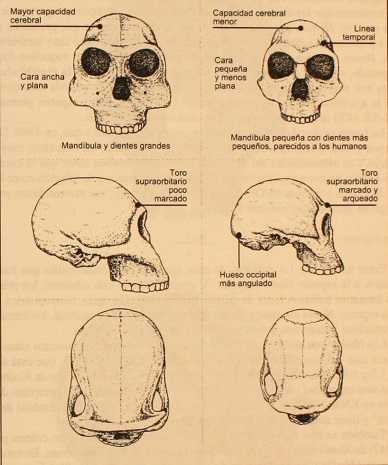{.lightbox}

Illustrating the morphological differences between *H. habilis* (right) and *H. rudolfensis* (left). In looking this over, try to determine if the distinction is simply in scale (size only differences) or in kind (notably different morphological attributes). Sorry it's in Spanish. 

:::

The debates get much simpler after the previous overview. This is in part because they fall back on questions of *how much variation* to allow and in part because aspects of the previous argument are really kinda weird (i.e., the aversion to transitional
morphologies). Further, the arguements regarding species assignments within the genus Homo are far better at representing the divide between lumpers and splitters. In each case, the distinction lies in whether we account
for regional variation within a single species or if each variant should represent a species on its own. 

The divide between the earliest of Homo species (*H. habilis* and *H. rudolfensis*) is tricky. They both appear in the fossil record around the same time (~2.1-1.8 Ma) and are found in the same region (East Africa). While it can be argued 
that *H. habilis* occurs before *H. rudolfensis*, current research struggles to appropriately sort different fossils across these two taxa (@Anton2014; @Kimbel2009; @Spoor2015; @Zanolli2026)
and so there is some difficulty in sorting the species into early and late occurrences. Despite this, research on the pooled sample of Early Homo fossils (including both proposed species) suggest that, despite the scant fossil material, the variation 
observed falls well-outside the expected range for a singular species (@Villmoare2018; @Davies2024; @Lieberman1996). In considering the crania associated with each (@fig-habrud) some authors have suggested that the distinction is largely a reflection of
<span title="differences between the males and females of a species"> **sexual dimorphism** </span> or indicative of progressive anagenic change on the way to *H. erectus*. Not surprisingly, the arguements present strong and valid evidence on both sides of
the field. For now, while the current paradigm is leaning more strongly towards a two-species diagnosis, the problem of sparse and fragmentary fossils remains a distinct hurdle (only one decent *H. rudolfensis* skull). Until we find more fossils from this time
period, keeping a conservative view of Early Homo (one species) will continue to be the consensus in the textbooks. This is perhaps one of the greatest strengths of the lumper philosophy, they do not make rash diagnoses. The approach emphasizes that
we do not know what the species looked like at the population level until we have a population-level sample size (more than a couple of fragmentary fossils). 


## *H. erectus* vs. *H. ergaster*

::: {#fig-erectus1 style="float: left; margin-right: 15px; max-width: 20%;"}
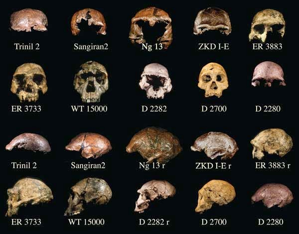{.lightbox}

Overview of cranial variation in *H. erectus* fossils. At least 4 different morphological patterns are recognized (approximated by NG13, ZKD I-E, ER 3733, and D 2700).

:::

*Homo erectus* is major species of interest in paleoanthropology. It illustrates the first species to develop modern human limb proportions (making it a far more proficient biped), lose most of the ape-like body hair while simultaneously evolving
a high concentration of sweat pores and dark skin for enhanced thermoregulation (see super cool research on skin color below), become endurance hunters, and to control and use fire (for cooking, warmth, protection, et cetera).
It is attributed with increased cognitive abilities as illustrated by the learned mental template for the Acheulean Handaxe and inferred cooperative and systematic hunting as well as through its navigation of environments leading to 
a more global distribution (likely the first to venture outside of the African continent). The significance of *H. erectus*, therefore, cannot be overstated.

The global distribution of *H. erectus* is both fascinating and problematic for discussions of taxonomy. As with other "cosmopolitan" species which exhibit global ranges, there are distinct differences between far separated populations. Of particular
note are the distinctions between East African and East Asian assemblages (also between East Asian and SE Asian populations, to a lesser degree). Especially when the respective fossil populations were first discovered, researchers perceived a 
large morphological gap that would, in many other circumstances, justify the separate species designations. Thus, *H. erectus* was ascribed to the fossils found throughout East and SE Asia (first named by Eugene DuBois) and *H. ergaster* was 
attributed to the East African fossils. These were represented mostly by specimens such as ER 3733 in East Africa and NG 13 from SE Asia (@fig-erectus1). As more fossils became known, however, the degree of difference between the two regions became 
less stark. East Asian <span title="distinct groups of organisms that share identical or very similar physical and structural characteristics"> **morphotypes** </span> began to appear in East Africa (e.g., OH 9) and fossils found in West Asia (Dminisi, Georgia)
appeared to represent both forms. 

While dedicated splitters still commit to differentiating the populations, a vast majority of paleoanthropologists recognize the divide one based on inconsequential traits and differences in size. With a greater abundance of fossil material than 
that related to the prior debate (*H. habilis* vs *H. rudolfensis*), detailed analyses of *H. erectus* variation has benefitted from a decently large cranial sample. Such efforts illustrate that the differences between regional populations
of this species amount to less variation than is seen in modern human populations from different global regions (@Anton2003a; @Baab2008; @Baab2016; @Rightmire1998b). 

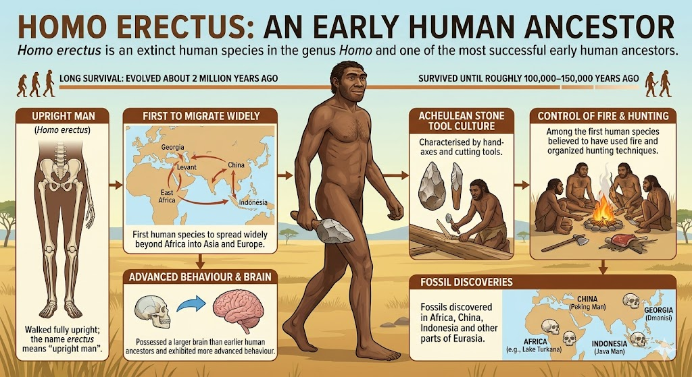{#fig-erover .lightbox width="60%"}

::: {#fig-skin .text-center}


Really cool research on the evolution of skin color. 
:::

 
 
# The Problem with Archaic *H. sapiens*

::: {#fig-bodo style="float: left; margin-right: 15px; max-width: 20%;"}
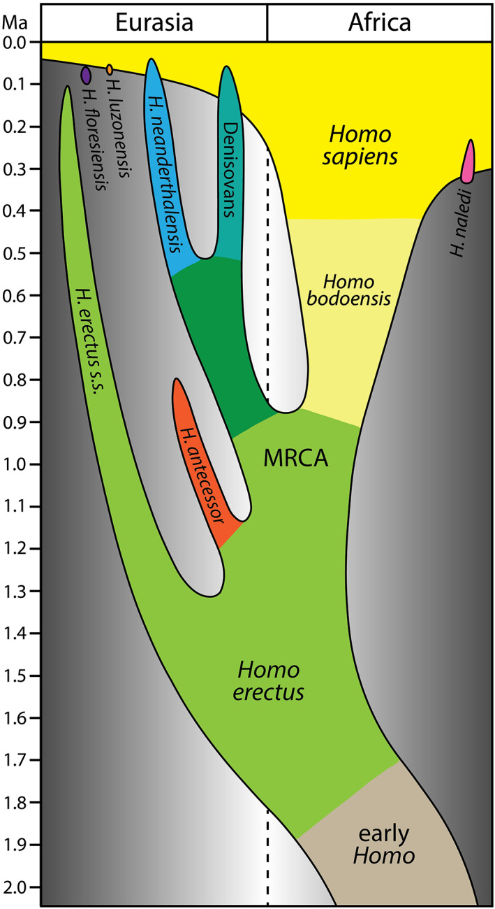{.lightbox}

Recent proposed Middle Pleistocene phylogeny. Note how Neanderthals and Denisovans are on a separate evolutionary line from *H. sapiens*. Further, while *H. bodoensis* on this line, the corresponding portion of the Neanderthal line (dark green) encompases
what might be called *H. heidelbergensis* or *H. rhodesiensis*). This graphic came from an article published with UH Manoa researcher/professor in Anthropology, Dr. Christopher Bae.

:::

Your reading for this week covered two chapters written by very different anthropologists. While I generally like the approach of Chapter 10 on Early Homo, I have some issues with Chapter 11. Specifically, the decision to use the
term "Archaic *Homo sapiens*" is highly problematic. While I often like gradistic descriptors to carry on a conversation (like we often do for Early Homo), this group is notably muddled and misleading (@bae2023; @roksandic2022a; @roksandic2022b).
Without making a big argument about the existence and placement of fossil species such as *H. heidelbergensis* (of which is highly contentious), there is one strong issue at hand that you should all be able to grasp at this point. Implementing
an "Archaic *Homo sapiens*" grade suggests that every fossil population encompassed by the group is directly on the evolutionary line to *Homo sapiens*. This is blatantly not the case with many of the fossils mentioned under this tag in the textbook.

The low hanging fruit in this discussion is the authors' decision to include Neanderthals in the grade. If you haven't realized it yet, Neanderthals [**did not**]{ .underline} evolve into *H. sapiens*. These populations are sister-taxa which diverged
from a common ancestor. Calling *H. neanderthalensis* an Archaic *H. sapiens* directly contradicts our current understanding of the human fossil record. This is likely to be true also for *H. heidelbergensis* (which is itself roughly synonymous with 
*H. rhodesiensis* and *H. bodoensis*) but there are more pressing taxonomic questions regarding the division of this particular group. 

The takeaway here is that, if we are going to employ a grade such as Archaic *H. sapiens*, the fossils attributed to this grade must at least be thought to be on the *H. sapiens* line. Plain and simple. 


# Stone Tools

When investigating tool use in the human fossil record, two points of contention often arise. The first of these involves how we identify the earliest evidence of *tool use*. This is more specifically directed at when we can first see the application
of stone tools to animal butchery and, therefore, the advance of carnivory (shift in adaptive zone). Claims of "cut marked" animal bones from sites such as Dikika and Bouri in Ethiopia dominate this discussion as they both predate the earliest evidence
of manufactured tools. The second area of interest, then, is how we identify the earliest *stone tool industries*. We will come to see that these industries are distinct
in paleoanthropology. They relate something very much different than the opportunistic use of tools in non-human primates and preclude the rudimentary fragmented stones that sometimes appear from such expediency (see Lomekwian tools below).

While it may seem like these two issues are necessarily 
bound together, they appear differently in the fossil record and have influenced different perspectives on when, where, and by whom tool using cultures were first developed. The next couple of sections discuss some of the debates regarding stone tools
and evidence of animal butchery. Each of the points here were mentioned briefly in the text but deserve a bit of explanation. 

### *Indirect* Evidence of Tool Use (Taphonomy)

::: {#fig-taph style="float: right; margin-right: 15px; max-width: 20%;"}
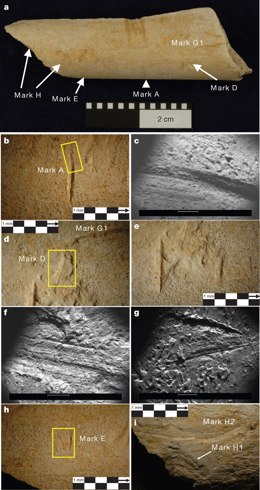{.lightbox}

High resolution images and CT scans of assumed taphonomic evidence of butchery. These materials from Dikika were later determined to have been modified by carnivore feeding.

:::

Difficulties arise when attempting to answer questions concerning the behavior of our human ancestors. Since behavior itself does not fossilize, anthropologists look to the field of <span title="the study of post-depositional processes"> ***taphonomy*** </span>
to discern discrete traces of a wide variety of past activities. While not an exact science, this research has become a necessary component of osteological analysis in zooarchaeology, forensic anthropology, and human origins studies. 
Taphonomic investigation has been incorporated into paleontological research since the early 19th century, centering on how we interpret post-mortem processes that alter organic material. Those who focus in this research investigate 
all possible agents that have acted on a once living organism (typically vertebrate) from the moment it died to the moment it was recovered in survey or excavation.

The most common application of taphonomic analysis in anthropology concerns the reconstruction of human subsistence patterns. Often situated in the narrower field of zooarchaeology, an inspection of <span title="animal bones"> **faunal elements** </span>
may lead researchers to answer questions of early human diet, animal procurement strategies, and predator-prey relations (@Lyman1994). Broadly, these investigations seek to determine if the materials found were initially deposited due to natural 
processes or as a result of human activity. Bone modifications resulting from human behavior typically occur during the animal butchery process  (the reduction of carcasses into consumable parts) (@Lyman1987; @White1992). This process includes the 
skinning, dismembering, and defleshing of an animal, as well as the extraction of marrow and brain tissue via bone fracture (@White1992). All of the aforementioned actions may leave diagnostic taphonomic signatures on bone and can be observed as such. 
The identification of these signatures is one of the most widely used methods employed when discussing ancient human behavior and are typically presented as bone scaring and/or fracturing. Such lines of evidence, however, are difficult to interpret 
and even more difficult to prove as diagnostic of a specific behavior (@Binford1981).

Any number of African Plio-Pleistocene fossil sites could provide a convincing case for hominin presence. While researchers are often careful to limit such interpretations to sites containing associated hominin fossils or artifacts, recent years
have shown resurgence in a reliance on indirect evidence. This was highlighted by the 2010 claim for humanly modified bones occurring across 3.39 million year old sediments in Ethiopia’s Lower Awash Valley. Recovered by the Dikika Research Project (DRP), the
fossilized faunal elements, incised with long fine striations, predate previously recognized butchery marks by nearly 800,000 years (@McPherron2010; @McPherron2011). While this temporal difference initially draws skepticism, the idea of tool use 
in australopithecines is not entirely outlandish (see below). The taphonomic evidence presented by the DRP, however, was minimal and unsubstantiated when considered against other known modifying agents (i.e., carnivore teeth marks). After having identified the
abrasions as “high confidence stone-tool cut marks”, critics were quick to question the contextual, anatomical and morphological properties of the found fossils (@McPherron2010; @Njau2012).

Subsequent research of the Dikika remains illustrated that, rather than human induced cutmarks, the bones were marked by the abrasions left by crocodile teeth (@Njau2012). The Dikika taphonomic signatures have therefore been largely dismissed 
as evidence of butchery. While this does not prove that hominins were incapable of butchering animals and consuming animal protein, it does mean that evidence of this process without the direct association of stone tools is a tenuous process.
Even the more widely accepted taphonomic cases in paleoanthropology (such as Bouri) are highly scrutinized and more commonly being dismissed with new analytical advances (@Sahle2017). Thus, the evidence of tool use and carnivory prior to 
the appearance of the Oldowan Tool Industry (and *H. habilis*) is yet insufficient to illustrate the adaptive shift in human evolution. 


### *Indirect* Evidence of Tool Use (non-human analogs)

::: {#fig-chimps style="width: 300px; float: left; margin-left: 20px; margin-bottom: 15px;"}

```{=html}
<div id="chimpSlider" class="carousel slide" data-bs-interval="false" style="width: 100%; overflow: hidden; position: relative;">
  
  <!-- Carousel Image Slides Track -->
  <div class="carousel-inner">
  
    <!-- Slide 1 (active) -->
    <div class="carousel-item active" style="position: relative;">
      <!-- Slide Number Badge overlaying the top-right corner -->
      <div class="carousel-caption" style="position: absolute; top: 10px; right: 10px; left: auto; bottom: auto; padding: 0; z-index: 10;">
        <span style="background: rgba(0, 0, 0, 0.65); color: #fff; padding: 4px 8px; border-radius: 4px; font-size: 12px; font-weight: bold; font-family: sans-serif;">1 / 2</span>
      </div>
      
	  <a href="../images/Homo/chimpuse.jpg" class="lightbox" data-gallery="phylo-gallery" title="Chimp tool using" data-description="Chimpanzees using stones to crack Panda nuts in West Africa">
        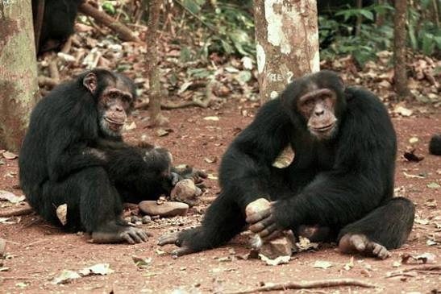
      </a>
    </div>
    
    <!-- Slide 2 -->
    <div class="carousel-item" style="position: relative;">
      <!-- Slide Number Badge -->
      <div class="carousel-caption" style="position: absolute; top: 10px; right: 10px; left: auto; bottom: auto; padding: 0; z-index: 10;">
        <span style="background: rgba(0, 0, 0, 0.65); color: #fff; padding: 4px 8px; border-radius: 4px; font-size: 12px; font-weight: bold; font-family: sans-serif;">2 / 2</span>
      </div>
      
      <a href="../images/Homo/chimptools.jpg" class="lightbox" data-gallery="phylo-gallery" title="Flakes from chimpanzee tool use" data-description="These, among other forms of debitage, are not a far cry from the aftermath of early hominin tool production">
        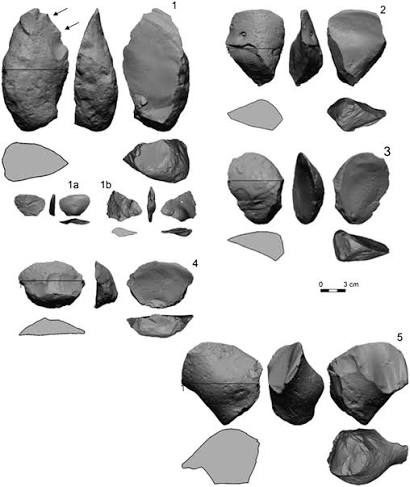
      </a>
    </div>
    
	
  </div>
  
  <!-- Left Control Arrow -->
  <button class="carousel-control-prev" type="button" data-bs-target="#chimpSlider" data-bs-slide="prev">
    <span class="carousel-control-prev-icon" aria-hidden="true" style="filter: invert(1); transform: scale(1.0);"></span>
    <span class="visually-hidden">Previous</span>
  </button>
  
  <!-- Right Control Arrow -->
  <button class="carousel-control-next" type="button" data-bs-target="#chimpSlider" data-bs-slide="next">
    <span class="carousel-control-next-icon" aria-hidden="true" style="filter: invert(1); transform: scale(1.0);"></span>
    <span class="visually-hidden">Next</span>
  </button>
  
</div>

<!-- Inline CSS to make sure text layout behaves nicely on phones -->
<style>
@media (max-width: 576px) {
  div[id^="fig-chimps"] {
    float: none !important;
    margin: 0 auto 20px auto !important;
  }
}
</style>
```

The splitter approach removes *H. habilis* from the Homo line and groups it with Australopithecus. They would then shift the entire Homo lineage down and link it to a single common ancestor with Australopithecus (probably Ardipithecus). See images 2 and 3
in this slider for insight into how this would look.
:::

Taphonomy aside, we should expect that australopithecines were tool users. This premise is well-accepted in our field with an underlying knowledge that behavioral changes tend to precede anatomical changes. This may sound somewhat 
[Lamarckian](Evolution.qmd#jean-baptiste-lamarck) but, on an evolutionary timeline, it's true. Thus, hominins are likely to have been using stones as tools and even producing stone tools of a sort long before we have a strong archaeological record of it. 
While there is little question that *tool industries* were first propagated by members of our genus, using stones as tools would not have been a novel behavior. Observational and experimental studies with chimpanzees, for instance, suggest that the 
earliest origins of tool manufacture may not have been such a great cognitive leap. 

Chimpanzees, having lesser relative brain size than *Au. africanus* and comparable brain size to *Au. afarensis*, are well-established tool users (@Panger2002). Specifically, the nut-harvesting chimpanzees of West Africa (Ivory Coast, Guinea, and
Liberia) set a good model for early stone tool using capacities in the hominin line. When first documented in 1844, chimpanzees were said to crack nuts in the same manner as humans. As interest in this activity grew, more detailed
investigations depicted the highly intellectual and even cultural nature of chimpanzee tool use. Behaviors which factored into this included preferential selection and transport of
materials, mental mapping of resource areas, and transmission of tool using behavior to younger generations.

Christophe and Hedwige Boesch began reporting more thorough accounts of chimpanzees using “natural hammers” in 1981 (@Boesch1982; @Boesch1990). Their work was performed along the N’Zo-Sassandra River in Taï National Park, Ivory Coast,
beginning in 1979 and lasted for three years. The chimpanzees in this region processed nuts seasonally, from February to August, and acquired an estimated 3000 calories a day from it (@Mercader2007). The highest value, and most sought after nut in this region
grows from the *Panda oleosa* tree. Having too hard a shell to crack with a wooden club, chimps seek out stones of granite and laterite to use as tools. Given the relative scarcity of stones, especially granite, the materials were presumed to have been selected and
transported from off-site outcrops as far as 500 meters away. Stones were then used excessively for long periods of time (according to use wear) and carried with individuals across different sites (@Boesch1982). During their research the authors noted
higher selection for lighter, though adequately hard, hammers when moving to trees farther away. Not being able to see many of these trees at the time of tool selection, it was presumed that they chose stones based on their knowledge of the distance between sites
and the costs of carrying a weighted tool.

::: {#fig-monkey style="float: right; margin-right: 15px; max-width: 20%;"}
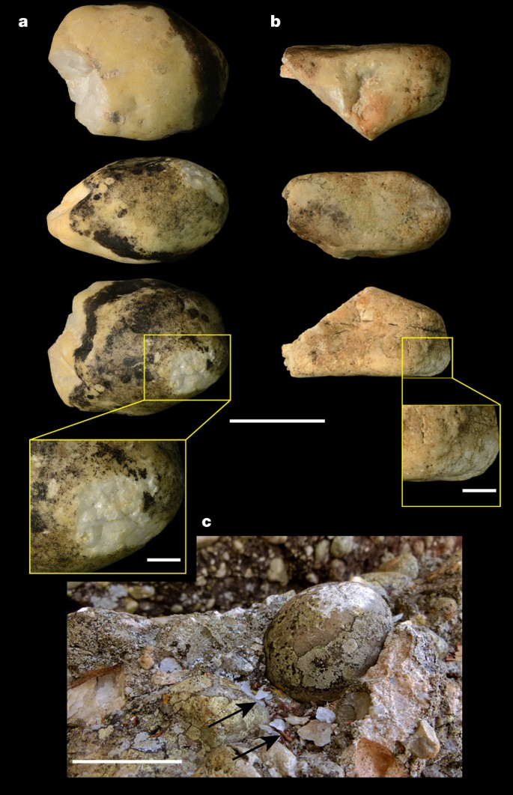{.lightbox}

Even Capuchin monkeys use stones as tools and, to some degree, generate an archaeological record of tool use (@Proffitt2016).
:::

The importance of Panda nuts, and the tools needed to extract them, is further highlighted in these studies by the transmission of nut-cracking strategies to younger troop members. Taught in three stages, young chimpanzees begin to learn to proficiently
crack nuts by the time they are three years old. Mothers first leave stones and nuts at an anvil site to stimulate interest in their young. To facilitate the action they allow the then curious infant to take resources from them during harvest. Finally, if the mother does not
think the juvenile is properly using the tool, she will actively teach them to do so (@Boesch1994). These behaviors were identified in a single troop on four separate occasions, leading the authors to consider stone tool use as culturally unique to the chimpanzees
along the N’Zo-Sassandra River in Taï Park (@Boesch1994). The behaviors exhibited by the Taï Park chimpanzees reflect multiple levels of complex thought beyond that of opportunistic tool use. They portray an understanding of material structure and
durability, distribution of resource sites within their environment, and the significance of teaching this behavior to their young.

When such observations are related to discussions of hominin tool use, it is likely safe to assume that the australopiths had the same cognitive capacity for this behavior as modern Great Apes. Problems arise, however, when correlating modern behavioral
studies with archaeological populations. To do so appropriately, it becomes necessary to match the material aftermath of chimpanzee tool sites with archaeological sites. Though few in number when compared with hominin tool assemblages, a handful of “chimpanzee
stone age” (CSA) sites have been identified in West Africa (@Mercader2007). The sites date to roughly 4,300 BP and are isolated from nearby human cultural areas. Among the scatter of nutshells and anvils, researchers at the site of
Panda 1 identified 4,500 grams of fractured stone. Interpreted as the unintentional result of continual percussive actions, the found debitage is said to resemble some earlier Oldowan artifacts. Overall, however, the materials were suggested as too simple to be
readily identified as the consequence of tool using without other associated artifacts (@Mercader2007). While too ambiguous to be archaeologically visible on their own, these debitage scatters do provide insight into how flaked tools may have first occurred.

This draws up an important point when discussing tool-making as a distinct hominin behavior. The importance placed on this behavioral shift is not associated with the use of tools, the selectivitity of materials, or even the production 
and use of broken stone implements. The evolutionary significant phenomenon that is under investigation is the development of [**Stone Tool Industries**]{ .underline}. This is of particular importance when comparing the supposed "Lomekwian" tools
with the later Oldowan Tool Complex, as we will see below. 

### Stone Tool Industries

Using [Tool Industry]{ .underline} as a category is not far off from our general approach to taxonomy. There should be a degree of discerable morphology and an associated behavior that qualifies the material to fit into distinct categories. Much like the fossils we
are studying, the larger the <span title="number of individual data points"> **sample size** </span> the more confidence we have in the classification, with those materials falling outside of the established range of variation being subject to 
criticism and exhausting debate. 

Tool industries benefit from being recognizable and describable. Even the simplest industry, the Oldowan Tool Complex, has unique identifiable qualities. Though they may look very much like randomly broken rocks when seen on their own, when seen together there
appears a clear pattern of development. The uniformity in design conveys a few important insights to us when considering human evolution. First, it suggests that the creation of these tools is intentional (not always easy to determine).
Second, it suggests the tool making was planned (materials were *chosen* for this purpose). Finally, and very important to the discussion, this uniformity through time and space suggests that the process of tool making was [taught]{ .underline}. These three
aspects of tool manufacture are similar to what was seen with the chimpanzee example above, except that the intent here is not just to use a stone as a tool but to fashion a stone into a better tool. And so we get to the problem at hand, are our earliest
examples of stone tools in the human fossil record a reflection of stones being used as tools or as stones being manufactured into tools? This question has been pretty-well put to bed for the Oldowan Tool Industry (clear, intentional manufacture) but
is still highly relevant to the recently discovered Lomewian tools. 

### Lomekwian

This topic is still very much alive in paleoanthropological debate and one that I am not super familiar with, so bear with me. 

::: {#fig-lomekwi style="float: left; margin-right: 15px; max-width: 20%;"}
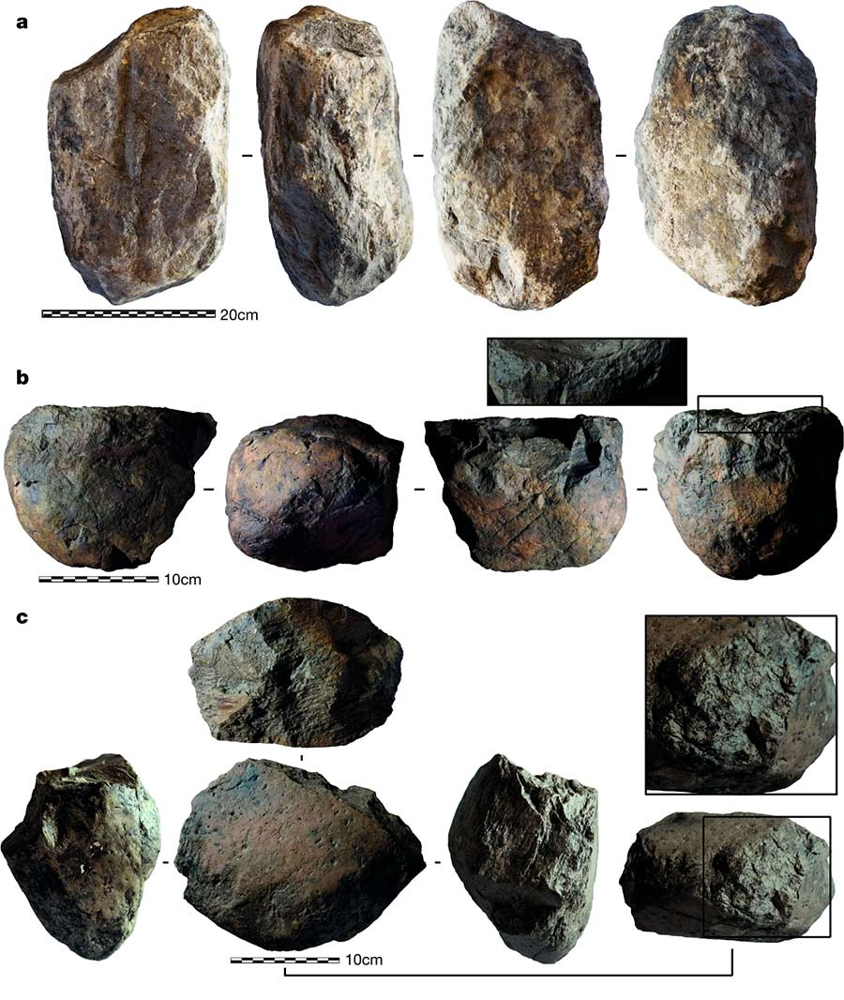{.lightbox}

3.3 Ma stone tools from the Lomekwi 3 site, West Turkana, Kenya
:::

Until 2015 the earliest recognized stone tools represented the 2.5 Ma Oldowan Industry first defined by Louis Leaky in mid-20th century. As described in your text, these tools are simple but distinct in their pattern of manufacture and predictable outcome 
(typically in the form of an Oldowan Chopper). These tools were likely developed to better facilitate the somewhat simple task of breaking bones for the extraction of bone marrow. For this purpose, the primary modification of a stone <span title="primary stone implement" **core** </span>,
involved hitting it with a large <span title="stone used for stricking the core"> **hammerstone** </span> in an effort to remove a <span title="piece of fractured stone remopved from a core"> **flake** </span>. This created the **Oldowan Chopper** which
was, for all intents and purposes, a handheld rock with one sharp side. These hominin tool makers could then use the implement to chop at long bones that would break open and expose the nutrient rich marrow. Thus we define the Oldowan Tool Industry.

The 2015 publication on the 3.3 Ma Lomekwian tools, however, introduced new discussions of how such industries should be defined (@Harmand2015; @Lewis2016). These *very* rudimentary tools consisted of cores, flakes, hammerstones, and anvils.  The discoverers
claim that the materials were then used for processing meat (therefore illustrating the adaptive shift) but research on the site and the tools themselves do not quite agree. While their are animal bones found at the Lomekwi site, none of these illustrate
the striations that would be expected from butchery (see taphonomy discussion above). Heck, they don't even show carnivore teeth marks. So if the tool makers were processing meat, it would have been done somewhere away from the manufacturing site.
Many authors reference the taphonomic material from Dikika as potential support for the argument, but the Dikika material has already been successfully disproven. Further, paeloarchaeologists have methods to determine what stone tools were used for by
examining the microscopic signatures left on their cutting surfaces. As of yet, none of the materials seem to have been used for animal carcass processing (@Plummer2025). 

It seems that Lomekwian tools were unlikely used for the adaptive shift associated with hominin carnivory. That said, the appearance of these tools could illustrate something new in hominin behavior at this time. Given the co-occurence of these
implements with *Au. afarensis*, if they were to reflect a pattern distinct from what is seen in non-human primates, they would still show an advance in behavior along our evolutionary line. The verdict on whether or not this is the case is still out.
Many researchers pursuing the matter are quick to point out that the process of making Lomekwian tools is at a distinctly higher cognitive level than that seen from Capuchin monkeys (see @fig-monkey), but the divide between Lomekwian and CSA material
is far less clear. @Lombard2019, for instance, illustrates that intentional flake production would have required a more complex cognitive process for the hominin tool makers than chimpanzees, but there is currently little evidence suggesting that
the production of flakes is the intended outcome. Otherwise, the *passive hammer knapping* and *bipolar flake production* are remarkebly similar to the Panda nut processors from West Africa. This is not the case, however, with the production of Oldowan
tools which were constructed through hand-held techniques (holding the core in one hand and hammerstone in the other during production) and, to some degree, illustrate the intentional resharpining (*retouching*) of flakes for continued use (@Mesfin2026; @Plummer2025).

In sum i'll stress again that the arguments surrounding Lomekwain tools are something that I am less familiar with (never been much of an archaeologist). My first impression was that they illustrated little difference from the sort of debitage
seen in other cases of expedient tool manufacture and/or unintentional tool shaping. That being said, some of the Oldowan materials I have seen are not too far off from this. What I can say with some confidence is that these "tools" so far
do not illustrate the same sort of adaptative shift as later tool indutries and are therefore less significant to our general discussion of major shifts in human evolution. 

# Pau

\


